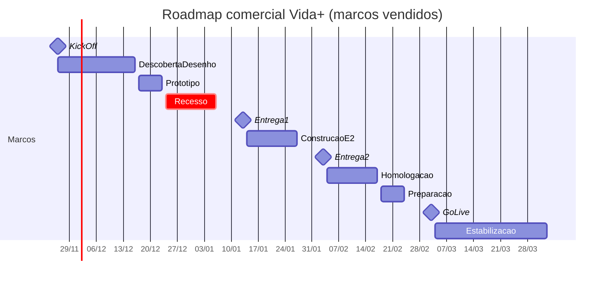

# 09 — Roadmap

**Projeto:** Vida+ — Sistema de Gestão e Agendamento de Clínica  
**Responsável pelo artefato:** Pessoa 2 — Escopo e produto  
**Status:** Rascunho inicial para validação na reunião do grupo  
**Base:** handoff `VidaMais - KT Projetos - Goofy Jello.pdf` (seção 9), [Decisão 4](../planejamento/00-reuniao-de-decisoes.md), [02 Escopo, Premissas e Restrições](02%20Escopo%20Premissas%20e%20Restricoes.md), [08 Product Backlog](08%20Product%20Backlog.md) e definições das Aulas 18 e 20.

## 1. Objetivo

Mostrar a **linha do tempo comercial vendida** (seção 9) e, em cada janela, **quais grupos de itens do Product Backlog** entram, são construídos ou são aceitos, de forma que escopo, backlog, cronograma e custos falem a mesma linguagem.

**Objetivo do produto no primeiro go-live:** operar em **03/03/2027** nas **quatro unidades em operação** com o incremento acumulado das Entregas 1 e 2 dentro da fronteira do artefato 02.

**Responsável pela ordenação no dia a dia (Decisão 3):** Bruno Ferraz, validando com Paula Ribeiro e Dra. Helena Moraes — alinhado ao papel de **Product Owner** no sentido da Aula 20 (maximizar valor e manter o backlog transparente), sem alterar as datas já vendidas ao cliente.

## 2. Critérios adotados

Conceitos aplicados conforme o material das aulas, a [Decisão 1](../planejamento/00-reuniao-de-decisoes.md) (abordagem híbrida) e o guia da Pessoa 2:

| Conceito | Definição aplicada neste roadmap | Fonte |
|---|---|---|
| **Roadmap** | Visão temporal de **marcos e incrementos** alinhada à linha de base contratual; não substitui o cronograme de atividades da Pessoa 3. | Guia Pessoa 2 + Aula 20 (transparência) |
| **Marco comercial** | Data ou janela **já vendida** ao cliente (kick-off, entregas funcionais, homologação, preparação, go-live). | PDF seção 9 + Decisão 4 |
| **Incremento** | Software **utilizável e verificável** nas Entregas 1 e 2; evidência de progresso, não só documento ou protótipo. | Aula 18 (princ. 3, 7, 8) + Aula 20 |
| **Abordagem incremental** | Capacidades entram **por partes**: Entrega 1 (cadastros e agenda) antes da Entrega 2 (portal, recepção, notificações, indicadores, VidaFin). | Aula 18 + [08 Product Backlog](08%20Product%20Backlog.md) §3 |
| **Colaboração sem romper contrato** | Feedback e ajuste de prioridade **dentro** da fronteira do go-live; itens fora ou adiados só por [Fluxo de Mudança](../pessoa_4/Fluxo%20de%20Mudança.md). | Aula 18 (valor 3) + Aula 07 |
| **Ritmo sustentável** | **Recesso** sem promessa de construção ou entrega funcional; retomada explícita na Entrega 1. | Aula 18 (princ. 8) + Decisão 4 |
| **Depois / CR** | Itens Z-01, Z-02 e Z-07 aparecem **após o go-live**, **sem data** nesta linha de tempo. | Artefato 02 + backlog §7 |

Este artefato **não** define Sprint, Sprint Backlog nem eventos Scrum: serão tratados em aula futura (plano de ensino, Etapa 3), como já registrado no backlog.

## 3. Visão da linha do tempo (14 semanas comerciais)

Kick-off **26/11/2026** · Go-live **03/03/2027** · OS até **100 dias corridos** (artefato 02).

| Sem. | Período (comercial) | Fase / marco vendido | Tipo de progresso (Aula 18) |
|---:|---|---|---|
| — | 26/11/2026 | **Kick-off** | Início formal; alinhamento de governança e backlog |
| 1–3 | 26/11–16/12/2026 | **Descoberta e desenho funcional** | Entendimento, decisões, desenho; **sem** incremento de produto aceito |
| 4 | 17–23/12/2026 | **Protótipo** (UX/jornadas) | Feedback e validação visual; **não** conta como Entrega funcional |
| 5–6 | 24/12/2026–06/01/2027 | **Recesso** | Sem construção nem entrega prometida (ver §6) |
| 7 | 07–13/01/2027 | **Entrega funcional 1** | **Incremento** PB-01 a PB-09 + aceite (5 dias úteis, PDF 7.4) |
| 8–9 | 14–27/01/2027 | *(Construção Entrega 2 — não é marco vendido)* | Desenvolvimento interno até disponibilizar Entrega 2 |
| 10 | 28/01–03/02/2027 | **Entrega funcional 2** | **Incremento** PB-10 a PB-15 + aceite |
| 11–12 | 04–17/02/2027 | **Homologação integrada** | Testes e aceite do conjunto; sem novos itens de backlog |
| 13 | 18–24/02/2027 | **Preparação de produção** | Ambiente, treinamento, carga em produção |
| 14 | 25/02–03/03/2027 | **Go-live** | Operação em **03/03/2027** nas quatro unidades |
| — | 04/03–02/04/2027* | **Estabilização (garantia 30 dias)** | Correção de **defeitos** do escopo entregue; fora das 14 semanas |

\* Início da garantia assume aceite do go-live em **03/03/2027** (artefato 02 §7.1).

### 3.1 Construção da Entrega 1 (sem marco intermediário vendido)

O contrato fixa **aceite da Entrega 1** a partir de **07/01/2027**. A construção de PB-01 a PB-09 deve ser alocada pela **Pessoa 3** nas **semanas 1–4** (descoberta, desenho e protótipo), com **parada no recesso** e conclusão técnica imediatamente antes da janela de aceite, **sem** criar marco novo nem mover datas da Decisão 4.

| Atividade de projeto (escopo do projeto — artefato 02 §4) | Onde no roadmap | Grupos de backlog |
|---|---|---|
| Descoberta e desenho funcional | Semanas 1–3 | Refino e dependências de PB-01 a PB-09; premissas P-01 a P-08 |
| UX/UI e protótipo | Semana 4 | Jornadas de agenda, portal e recepção (apoio a PB-06, PB-10, PB-12) |
| Desenvolvimento Entrega 1 | Semanas 1–4 (+ retomada pós-recesso se necessário) | **Implementação** PB-01 a PB-09 até ambiente de homologação da Entrega 1 |
| Aceite Entrega 1 | Semana 7 | Verificação dos critérios dos cartões PB-01 a PB-09 |

## 4. Grupos de backlog por janela

Rastreio: cada ID aponta para o [08 Product Backlog](08%20Product%20Backlog.md). Habilitadores (**H**) sustentam critérios de aceite de outros itens.

### 4.1 Descoberta e desenho funcional · 26/11 a 16/12/2026

**Objetivo da janela:** fechar entendimento, regras e dependências do cliente para as Entregas 1 e 2, sem prometer software aceito.

| Grupo | Itens PB | Foco |
|---|---|---|
| Governança e acesso | PB-01 (H), PB-02 (H) | Matriz de perfis (P-04), diretriz de auditoria |
| Estrutura clínica | PB-03, PB-04 | Unidades (quatro em operação + Indaiatuba cadastrável — Z-06), salas (P-07) |
| Pacientes e agenda (desenho) | PB-05, PB-06, PB-07, PB-08 | Regras clínicas (P-05, P-06), encaixe (Z-03) |
| Dados | PB-09 (H) | Layout de carga (P-02) |
| Entrega 2 (antecipação de risco) | PB-12, PB-13, PB-15 | Política de cancelamento (P-06), canal (P-03), API VidaFin (P-01) |

**Premissas com data-limite nesta janela (artefato 02 §6):**

| Data | Premissa |
|---|---|
| 02/12/2026 | P-05 (disponibilidade Dra. Helena), P-08 (responsável LGPD) |
| 09/12/2026 | P-04 (perfis e usuários-chave) |
| 16/12/2026 | P-01, P-02, P-03, P-06, P-07 |

### 4.2 Protótipo · 17 a 23/12/2026

| Grupo | Itens PB | Foco |
|---|---|---|
| Experiência agenda e recepção | PB-06, PB-07, PB-10 (protótipo) | Validar fluxo interno antes da construção pesada de E2 |
| Portal (protótipo) | PB-12 (protótipo) | Validar jornada do paciente; cancelamento conforme P-06 quando fechado |
| Gestão (protótipo) | PB-14 (protótipo) | Macros e filtros acordados com Paula |

**Saída esperada:** feedback para Developers e UX; **não** substitui critérios de aceite das entregas funcionais.

### 4.3 Entrega funcional 1 · 07 a 13/01/2027

**Incremento vendido:** software utilizável por usuários internos nas quatro unidades em operação (backlog §3).

| Grupo | Itens PB |
|---|---|
| Administração e segurança | PB-01, PB-02, PB-03, PB-04 |
| Pacientes | PB-05 |
| Agenda | PB-06, PB-07, PB-08 |
| Carga inicial | PB-09 |

**Fora deste incremento (previsto na Entrega 2):** portal, recepção digital, notificações automáticas em produção, indicadores consolidados, VidaFin.

### 4.4 Construção da Entrega funcional 2 · 14 a 27/01/2027

Janela **não vendida** como marco separado; concentra o desenvolvimento entre o aceite da Entrega 1 e a disponibilização da Entrega 2. A Decisão 4 já sinaliza pressão de prazo neste intervalo.

| Grupo | Itens PB |
|---|---|
| Recepção e fila | PB-10 |
| Atendimento administrativo | PB-11 |
| Portal do paciente | PB-12 |
| Notificações | PB-13 (baseline e-mail se P-03 não fechar canal extra) |
| Gestão | PB-14 |
| Integração VidaFin | PB-15 (condicionado a P-01) |

### 4.5 Entrega funcional 2 · 28/01 a 03/02/2027

**Incremento vendido:** portal, recepção, atendimento, notificações, indicadores macro e integração VidaFin **quando** P-01 se confirmar.

| Grupo | Itens PB |
|---|---|
| Mesmos de §4.4 | PB-10 a PB-15 (aceite conjunto na janela) |

**Parcela comercial associada (PDF 5.3):** homologação integrada — alinhada à sequência após esta entrega.

### 4.6 Homologação integrada · 04 a 17/02/2027

| Grupo | Escopo no roadmap |
|---|---|
| Produto | Conjunto **PB-01 a PB-15** já aceito incrementalmente; validação integrada e cenários Anexo C |
| Projeto | Apoio da Goofy Jello aos testes; correção de defeitos dentro do escopo entregue |
| Cliente | Usuários-chave (P-04), validações clínicas (P-05), aceite em até 5 dias úteis por disponibilização |

Nenhum item **novo** de backlog entra nesta janela sem Change Request.

### 4.7 Preparação de produção · 18 a 24/02/2027

| Grupo | Escopo no roadmap |
|---|---|
| Ambiente | Produção conforme responsabilidades do cliente (artefato 02 §7.3) |
| Pessoas | Treinamento de usuários-chave; comunicação de go-live (Pessoa 1) |
| Dados | Carga inicial essencial em produção (PB-09), se não concluída antes |
| Operação | Plano de go-live assistido (Pessoa 4 — artefato 12) |

### 4.8 Go-live · 03/03/2027

| Grupo | Escopo no roadmap |
|---|---|
| Operação | Primeira operação produtiva nas **quatro unidades em operação** |
| Produto | Fronteira do artefato 02 §3; **sem** Indaiatuba em operação (Z-06) |
| Aceite | Marco de go-live; início da garantia de 30 dias corridos |

### 4.9 Estabilização · garantia pós-aceite

| Grupo | Escopo no roadmap |
|---|---|
| Defeitos | Correções do escopo entregue (não melhorias — [Fluxo de Mudança](../pessoa_4/Fluxo%20de%20Mudança.md)) |
| Backlog de produto | **Sem** novos PB-XX na linha de base; evoluções adiadas ficam em §5 |

## 5. Pós go-live — sem data prometida

Itens da zona cinzenta **adiados**; entrada apenas por Change Request, coerente com o backlog §7.

| ID | Origem | Situação no roadmap |
|---|---|---|
| CR-01 | Z-01 WhatsApp | **Pós go-live** · sem data |
| CR-02 | Z-02 Reagendamento pelo paciente | **Pós go-live** · sem data |
| CR-03 | Z-07 Dashboard executivo | **Pós go-live** · sem data |

Exclusões permanentes do contrato (app nativo, TISS, telemedicina, cobrança online, migração ampla, operação Indaiatuba em 03/03/2027, etc.) **não** aparecem nesta linha do tempo; ver artefato 02 §5.

## 6. Recesso de fim de ano · 24/12/2026 a 06/01/2027

| Aspecto | Registro no roadmap |
|---|---|
| **Período proposto** | 24/12/2026 a 06/01/2027 — validar na reunião (célula em aberto na Decisão 4) |
| **Construção** | Sem atividades de desenvolvimento planejadas como compromisso |
| **Entregas** | Sem Entrega funcional nem disponibilização para aceite |
| **Backlog** | Itens PB permanecem visíveis; bloqueios e dependências do cliente documentados, sem prometer conclusão |
| **Motivo (aula)** | Ritmo sustentável e linha de base preditiva (Aula 18 princ. 8; abordagem híbrida — Decisão 1) |
| **Retomada** | Entrega 1 a partir de **07/01/2027** |

## 7. Mapa rápido PB × janela

| PB | Descoberta | Protótipo | E1 construção* | E1 aceite | E2 construção | E2 aceite | Homol. | Prep. | Go-live |
|---|:---:|:---:|:---:|:---:|:---:|:---:|:---:|:---:|:---:|
| PB-01–09 | R / D | P† | C | A | — | — | H | — | ✓ |
| PB-10–15 | R | P† | — | — | C | A | H | — | ✓ |

Legenda: **R** refinamento · **D** desenho · **P** protótipo · **C** construção · **A** aceite de entrega · **H** homologação integrada · **✓** em operação · † foco parcial nos fluxos de E2.

\* Construção E1 conforme §3.1 (semanas 1–4 + retomada pós-recesso se a Pessoa 3 alocar assim).

## 8. Coerência com backlog, cronograma e demais artefatos

- **[08 Product Backlog](08%20Product%20Backlog.md):** PB-01 a PB-15 cobrem o go-live; ordem e fronteira inalteradas neste roadmap.
- **[02 Escopo, Premissas e Restrições](02%20Escopo%20Premissas%20e%20Restricoes.md):** marcos da §4 (escopo do projeto) e datas da §7.1.
- **Pessoa 3 — [04 Cronograma](../planejamento/pessoa-3-prazo-e-custos.md):** deve derivar atividades, predecessoras, capacidade (recesso, caminho crítico do backend) e **mesmas datas** da tabela §3; o vão 14–27/01 é onde cabem horas de PB-10 a PB-15.
- **Pessoa 4:** premissas com data (§4.1) e compressão pós-recesso alimentam riscos (ex. R12 na matriz preliminar).
- **Pessoa 1:** validações e comunicação no recesso e nas janelas de aceite.
- **Revisão cruzada:** cada capacidade do go-live deve aparecer em Escopo → Backlog → **Roadmap** → Cronograma → Custos → Riscos → Qualidade → Go-live.

## 9. Pendências para validação do grupo

- Confirmar período exato do **recesso** (proposta 24/12/2026–06/01/2027) na reunião de decisões.
- Validar se a alocação de construção da Entrega 1 nas semanas 1–4 (§3.1) é factível com o teto de custo — decisão conjunta com a Pessoa 3.
- Se **P-01** não se confirmar, retirar PB-15 do incremento do go-live mantendo o marco de **03/03/2027** (premissa artefato 02).
- Após publicação do cronograma da Pessoa 3, confrontar marco a marco com esta tabela e ajustar **texto explicativo** aqui se houver paralelismo não óbvio (sem mudar datas vendidas).

**Pronto quando (issue #13):** o roadmap estiver **coerente com o backlog** e com o **cronograma da Pessoa 3** — isto é, mesmas janelas da Decisão 4, todos os PB do go-live alocados a fases, recesso visível, itens adiados sem data, e a Pessoa 3 conseguir encaixar atividades nas semanas deste arquivo sem contradição.