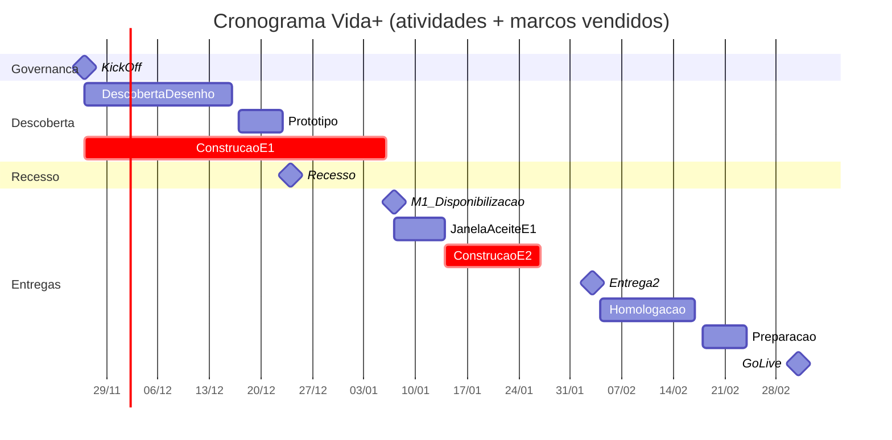

# 04 — Cronograma

**Projeto:** Vida+ — Sistema de Gestão e Agendamento de Clínica  
**Responsável pelo artefato:** Gustavo Vieira (Pessoa 3 — Prazo e custos)  
**Status:** Alinhado ao [05 Custos](05%20Planejamento%20de%20Custos.md) (1.096 h WBS) e à janela de QA da Entrega 1 (§3.2)  
**Base:** handoff `VidaMais - KT Projetos - Goofy Jello.pdf` (seções 5, 7, 8 e 9), [Decisão 4](../planejamento/00-reuniao-de-decisoes.md), [02 Escopo, Premissas e Restrições](../pessoa_2/02%20Escopo%20Premissas%20e%20Restricoes.md), [08 Product Backlog](../pessoa_2/08%20Product%20Backlog.md), [09 Roadmap](../pessoa_2/09%20Roadmap.md), [Matriz RACI](../pessoa_1/Matriz%20RACI%20Vida%20Mais.md) e Aula 08 — Planejamento e Gestão do Cronograma.

## 1. Objetivo

Traduzir o backlog e os marcos vendidos em **atividades**, **dependências**, **durações** e **datas**, de forma que o grupo consiga responder **quando** o go-live ocorre, **qual é o caminho crítico** e **qual o impacto** se uma entrega ou premissa do cliente atrasar.

**Resposta executiva (kick-off):** operação produtiva em **03/03/2027**, com Entrega funcional 1 em **07–13/01/2027** e Entrega funcional 2 em **28/01–03/02/2027**, respeitando recesso **24/12/2026–06/01/2027** sem construção comprometida.

## 2. Critérios adotados

| Conceito | Definição aplicada neste cronograma | Fonte |
|---|---|---|
| **Atividade** | Pacote de trabalho estimável, com responsável e predecessoras; deriva do backlog e das fases do projeto. | Aula 08 |
| **Marco** | Evento de controle com duração zero (data vendida ou aceite contratual). | Aula 08 + PDF seção 9 |
| **M1-D (disponibilização E1)** | Marco de **duração zero** em **07/01/2027**: pacote PB-01–09 liberado em homologação; inicia contagem dos **5 dias úteis** (PDF 7.4). **Go/no-go interno:** Camila/Natália — defeito bloqueador impede liberar. | Aula 08 + PDF 7.4 |
| **Janela comercial M1** | **07–13/01/2027** (Decisão 4): período **vendido** para homologação/aceite da Entrega 1; **não** é marco de um dia. | Decisão 4 |
| **Aceite M1 (cliente)** | Até **5 d.u. após M1-D** (ex.: até ~13/01 se disponibilização em 07/01). Marco contratual “Entrega funcional 1” = **janela**, não a data única do Gantt. | PDF 7.4 |
| **Esforço × duração** | Horas de trabalho ≠ semanas no calendário; duração depende da capacidade semanal da equipe. | Aula 08 |
| **Paralelismo** | UX com descoberta; frontend E1 após desenho, em paralelo ao backend; QA em ciclos nas janelas de entrega. | Aula 08 + guia Pessoa 3 |
| **Caminho crítico** | Sequência que determina a data final mínima; aqui, o eixo **backend (Rafael)** + compressão da **Entrega 2 (14–27/01)**. | Aula 08 |
| **Dependência do cliente** | Atividades com dono Vida+ (premissas P-01 a P-08); atraso vira bloqueio, não “folga interna”. | Aula 08 + artefato 02 §6 |

Este artefato **complementa** o [09 Roadmap](../pessoa_2/09%20Roadmap.md): o roadmap mostra **marcos e grupos de PB**; o cronograma mostra **quem faz o quê, em que ordem e com quantas horas por semana**.

## 3. Linha de tempo comercial (14 semanas)

Alinhada à tabela §3 do [09 Roadmap](../pessoa_2/09%20Roadmap.md) e à [Decisão 4](../planejamento/00-reuniao-de-decisoes.md).

*No Gantt abaixo: **milestone** = disponibilização (M1-D); **barra** = janela comercial vendida.*



| Sem. | Período | Fase / marco | Tipo de progresso |
|---:|---|---|---|
| — | 26/11/2026 | **Kick-off** | Marco (duração zero) |
| 1–3 | 26/11–16/12/2026 | Descoberta e desenho funcional | Atividades A01–A03; início A05–A07 (E1) |
| 4 | 17–23/12/2026 | Protótipo UX | A04; continuação construção E1 até 23/12 |
| 5–6 | 24/12/2026–06/01/2027 | **Recesso** | Sem desenvolvimento comprometido; GP apenas acompanhamento de premissas |
| 7 | **07/01/2027** | **M1-D — disponibilização Entrega 1** | Marco (duração zero); A10 libera PB-01–09; go/no-go interno |
| 7 | **07–13/01/2027** | **Janela M1 — aceite/homologação E1** | Cliente homologa PB-01–09; 5 d.u. a partir de M1-D; fechamento técnico A05–A09 na retomada |
| 8–9 | 14–27/01/2027 | Construção Entrega 2 | A11–A14 (PB-10a a PB-15) — janela crítica |
| 10 | 28/01–03/02/2027 | **Entrega funcional 2** (aceite) | Marco; A15 |
| 11–12 | 04–17/02/2027 | Homologação integrada | A16 |
| 13 | 18–24/02/2027 | Preparação de produção | A17 |
| 14 | 25/02–03/03/2027 | **Go-live** 03/03/2027 | A18 |
| — | 04/03–02/04/2027* | **Estabilização (garantia 30 dias)** | Apenas defeitos do escopo entregue; **sem** novas horas no orçamento deste plano |

\* Alinhado ao [09 Roadmap](../pessoa_2/09%20Roadmap.md) §4.9 e artefato 02 §7.1.

### 3.1 Recesso

| Aspecto | Registro |
|---|---|
| Período | **24/12/2026 a 06/01/2027** (validado com [09 Roadmap](../pessoa_2/09%20Roadmap.md) §6) |
| Construção | Nenhuma hora de desenvolvimento planejada como compromisso |
| Retomada | **M1-D** em **07/01/2027**; janela de aceite **07–13/01** (Decisão 4) |

A Entrega 1 é construída principalmente nas **semanas 1–4**, com **fechamento técnico orçado na semana 7** (horas A05†–A10 já no WBS — ver §3.2 e §6.2), **sem mover** M1-D nem a janela vendida.

### 3.2 Entrega 1 — QA, recesso, M1-D e janela de aceite

| Evento | Calendário | Atividades | Critério de conclusão |
|---|---|---|---|
| QA parcial (pré-recesso) | Sem. 4 (17–23/12) | A09 (**18 h** — §6.2) | Incremento E1 das sem. 1–4 testável internamente |
| Recesso | Sem. 5–6 (24/12–06/01) | — (GP: premissas) | **Zero h** de construção no WBS |
| Fechamento técnico (pré-liberação) | Sem. 7 (retomada) | A05–A08†, A09 (**24 h**), A10 (prep.) | Pacote pronto para **M1-D** |
| **M1-D — disponibilização** | **07/01/2027** | A10 | Go/no-go **interno**; protocolo datado; inicia 5 d.u. |
| **Janela aceite cliente** | **07–13/01/2027** | A10 (apoio) | Homologação PB-01–09; aceite ou tácito (PDF 7.4) |

O pacote **A09 (42 h)** = **18 h** (sem. 4) + **24 h** (sem. 7), alinhado à capacidade de Natália (§7) e ao [11 Plano de Qualidade](../pessoa_4/11%20Plano%20de%20Qualidade.md) §4.

**Recesso vs semana 7:** o recesso (sem. 5–6) **não** adiciona “tempo de recuperação” no calendário; a carga da semana 7 é **retomada planejada**, com horas **já contidas** no bottom-up (**1.096 h**, A01–A18). Não há rubrica de buffer nem hora extra — é **deslocamento de esforço** (mais construção sem. 1–4, fechamento sem. 7). Decisão registrada na revisão cruzada (§10).

## 4. Capacidade da equipe (premissa de cronograma)

Taxas e tetos conforme PDF seção 8 e [guia Pessoa 3](../planejamento/pessoa-3-prazo-e-custos.md). O cronograma usa **disponibilidade real**, não o máximo teórico em todas as semanas.

| Pessoa | Função | h/sem máx. | Como aparece no cronograma |
|---|---|---:|---|
| Camila Rocha | GP | 12 | Acompanhamento contínuo; picos em aceites e go-live |
| Bruno Ferraz | Analista de negócios | 16 | Descoberta/desenho (sem. 1–3); apoio homologação; não 100% em construção |
| Lívia Monteiro | UX/UI | 8 | Concentrada em sem. 1–4 (desenho + protótipo) |
| Rafael Nunes | Backend | 24 | **Caminho crítico**; E1 sem. 1–4 e 7; E2 sem. 8–10 |
| Diego Prado | Full Stack | 24 | Frontend E1/E2, APIs compartilhadas com Rafael |
| Natália Campos | QA | 16 | ~**8 h/sem** médias no projeto (restante sustentação); QA nas sem. 4, 7, 9–12 |
| Igor Mendes | DevOps | 4 | Agrupado em preparação de produção e releases (sem. 11–14) |

## 5. Dependências do cliente (premissas como atividades)

Registro para encaixar no cronograma; detalhes no [artefato 02 §6](../pessoa_2/02%20Escopo%20Premissas%20e%20Restricoes.md).

| ID | Atividade de dependência | Dono (Vida+) | Data-limite | Desbloqueia (PB / atividade) |
|---|---|---|---|---|
| P-05 | Formalizar disponibilidade Dra. Helena para validações clínicas | Ricardo Salles | 02/12/2026 | A03; PB-06, PB-08 |
| P-08 | Indicar responsável LGPD | Ricardo Salles | 02/12/2026 | A02; segurança homologação |
| P-04 | Aprovar perfis e usuários-chave | Paula Ribeiro | 09/12/2026 | A05 (PB-01) |
| P-01 | API/credenciais/ambiente teste VidaFin | Marcelo Viana + Fernanda Lopes | 16/12/2026 | A13 (PB-15) |
| P-02 | Amostra e layout carga pacientes | Paula Ribeiro | 16/12/2026 | A08 (PB-09) |
| P-03 | Canal de mensageria em produção | Juliana Reis | 16/12/2026 | A11 (PB-13; baseline e-mail) |
| P-06 | Política de cancelamento e remarcação pela equipe | Dra. Helena + Paula | 16/12/2026 | A11 (PB-12d) |
| P-07 | Planilha salas/recursos por unidade | Paula Ribeiro | 16/12/2026 | A06 (PB-03b, PB-06) |

Atraso em **P-07** ou **P-04** impacta o **caminho crítico** da Entrega 1; atraso em **P-01** condiciona PB-15 sem mover o go-live (premissa do artefato 02).

## 6. Lista de atividades (WBS)

PB referenciados conforme [08 Product Backlog](../pessoa_2/08%20Product%20Backlog.md). Esforços alinhados ao [05 Planejamento de Custos](05%20Planejamento%20de%20Custos.md).

| ID | Atividade | Resp. | Esforço (h) | Distribuição (h) | Semanas (calendário) | Predecessoras | Em paralelo com | Marco / PB |
|---|---|---|---:|---|---|---|---|---|
| A01 | Kick-off, baselines e planos integrados | Camila | 16 | S1: 16 | 1 | — | A02 | M0 Kick-off |
| A02 | Descoberta e refinamento do backlog (E1 e E2) | Bruno | 52 | S1–3 (§7) | 1–3 | A01 | A03, A05 | Refino PB-01–15 |
| A03 | Desenho funcional e workshops (agenda, perfis, portal) | Bruno | 48 | S1–3 (§7) | 1–3 | A01 | A02, A04 | PB-06, PB-07, PB-12a |
| A04 | Protótipo UX (agenda, recepção, portal, gestão) | Lívia | 78 | S2–4 (§7) | 2–4 | A03 | A05, A07 | PB-06, PB-10a–c, PB-12a–d, PB-14 |
| A05 | Backend — administração, segurança e cadastros | Rafael | 108 | S2: 28 · S3: 38 · S4: 30 · S7: 12 | 2–4, 7† | A03; P-04 | A06, A07 | PB-01–04 |
| A06 | Backend — pacientes, agenda e encaixe (Z-03) | Rafael | 130 | S3: 42 · S4: 44 · S7: 44 | 3–4, 7† | A05; P-07 | A07 | PB-05a–08 |
| A07 | Frontend — telas internas Entrega 1 | Diego | 112 | S3: 34 · S4: 40 · S7: 38 | 3–4, 7† | A03 (desenho) | A05, A06 | PB-01–08 (UI) |
| A08 | Carga inicial essencial e validação de layout | Diego, Rafael | 36 | S4: 14 · S7: 22 | 4, 7 | A05, A06; P-02 | A09 | PB-09 |
| A09 | QA — testes Entrega 1 e regressão interna | Natália | 42 | **S4: 18 · S7: 24** | 4, 7 | A07, A08 | — | PB-01–09 |
| A10 | Disponibilização e apoio ao aceite Entrega 1 (5 d.u.) | Camila, Natália | 24 | S7: 24 | 7 | A09 | — | **M1-D** 07/01; janela aceite **07–13/01**; PB-01–09 |
| — | *Recesso — sem atividades de construção* | — | 0 | — | 5–6 | (após QA parcial A09; antes de A10)‡ | — | — |
| A11 | Backend/FS — recepção, atendimento, portal, notificações | Rafael, Diego | 132 | S8–9 (§7) | 8–9 | A10; P-06, P-03 | A12 | PB-10a–14, PB-13 |
| A12 | Frontend — portal do paciente e recepção digital | Diego | 88 | S8–9 (§7) | 8–9 | A11 (APIs base) | A11 | PB-10a–12d |
| A13 | Integração VidaFin (evento de atendimento) | Rafael, Diego | 40 | S9–10 (§7) | 9–10 | A11; P-01 | A14 | PB-15 |
| A14 | QA — testes Entrega 2 | Natália | 46 | S9: 24 · S10: 22 | 9–10 | A12, A13 | — | PB-10a–15 |
| A15 | Disponibilização e apoio ao aceite Entrega 2 | Camila, Natália | 20 | S10: 20 | 10 | A14 | — | **M2** 03/02; PB-10a–15 |
| A16 | Homologação integrada e correção de defeitos | Natália + dev | 58 | S11–12 (§7) | 11–12 | A15 | — | Anexo C |
| A17 | Preparação produção, pipelines e treinamento | Igor, Camila | 36 | S13: 36 | 13 | A16 | A18 (início) | Ambiente prod. |
| A18 | Go-live assistido e hypercare inicial | Camila + equipe | 30 | S14: 30 | 14 | A17 | — | **M3** 03/03 |

† Semana 7: **fechamento técnico orçado** no WBS (horas † nas linhas A05–A08), não contingência nem marco novo.  
‡ Durante o recesso (entre QA parcial e fechamento), Camila acompanha status das premissas P-01 a P-08 (sem horas de dev).

**Total WBS (A01–A18):** **1.096 h** — idêntico ao §5.1 do [05 Planejamento de Custos](05%20Planejamento%20de%20Custos.md).

### 6.2 Atividades com calendário descontínuo (splits de horas)

| ID | Resp. | Total (h) | S2 | S3 | S4 | S7 | S9 | S10 | % S7* | §7 |
|---|---|---:|---:|---:|---:|---:|---:|---:|---:|---|
| A05 | Rafael | 108 | 28 | 38 | 30 | 12 | — | — | 11% | Natália 14 h sem.7 inclui A09 + apoio A10 |
| A06 | Rafael | 130 | — | 42 | 44 | 44 | — | — | 34% | — |
| A07 | Diego | 112 | — | 34 | 40 | 38 | — | — | 34% | — |
| A08 | Diego, Rafael | 36 | — | — | 14 | 22 | — | — | 61% | — |
| A09 | Natália | 42 | — | — | **18** | **24** | — | — | 57% | 12 h sem.4 + 14 h sem.7 (tabela §7) |
| A14 | Natália | 46 | — | — | — | — | 24 | 22 | — | — |

\* **% S7** = parcela do total da atividade executada na retomada sem. 7 (fechamento planejado).

Checagem: cada linha soma ao **Total (h)**; **Σ A01–A18 = 1.096 h** (inalterado).

### 6.1 Mapa PB × atividade de construção

| PB | Atividades principais |
|---|---|
| PB-01, PB-02 | A05 |
| PB-03a–c, PB-04 | A05 |
| PB-05a, PB-05b | A06, A07 |
| PB-06, PB-07, PB-08 | A06, A07 |
| PB-09 | A08 |
| PB-10a–c | A11, A12 |
| PB-11 | A11 |
| PB-12a–d | A11, A12 |
| PB-13 | A11 |
| PB-14 | A11, A04 (protótipo) |
| PB-15 | A13 |

Todos os itens **PB-01 a PB-15** do go-live possuem pelo menos uma linha de construção ou teste (A05–A16).

## 7. Visão por semana (recursos)

Horas planejadas por profissional (soma ≈ capacidade usada no [05 Custos](05%20Planejamento%20de%20Custos.md)).

| Semana | Período | Camila | Bruno | Lívia | Rafael | Diego | Natália | Igor |
|---:|---|---:|---:|---:|---:|---:|---:|---:|
| 1 | 26/11–02/12 | 12 | 14 | 6 | 20 | 12 | 4 | — |
| 2 | 03–09/12 | 12 | 16 | 8 | 24 | 18 | 6 | — |
| 3 | 10–16/12 | 12 | 16 | 8 | 24 | 20 | 8 | — |
| 4 | 17–23/12 | 10 | 10 | 8 | 22 | 22 | 12 | — |
| 5–6 | Recesso | 4§ | — | — | — | — | — | — |
| 7 | 07–13/01 | 12 | 8 | — | 24 | 18 | 14 | — |
| 8 | 14–20/01 | 12 | 6 | — | 24 | 24 | 10 | — |
| 9 | 21–27/01 | 12 | 6 | — | 24 | 24 | 12 | — |
| 10 | 28/01–03/02 | 10 | 6 | — | 20 | 16 | 14 | — |
| 11 | 04–10/02 | 12 | 8 | — | 16 | 12 | 16 | 2 |
| 12 | 11–17/02 | 12 | 8 | — | 14 | 10 | 16 | 2 |
| 13 | 18–24/02 | 12 | 6 | — | 8 | 8 | 10 | 8 |
| 14 | 25/02–03/03 | 14 | 4 | — | 8 | 8 | 10 | 8 |

§ Apenas governança e follow-up de premissas.

## 8. Caminho crítico

**Sequência crítica (calendário + esforço):**

```text
A01 → A03 → A05 → A06 → (recesso) → A09 → A10 [M1-D 07/01; janela aceite 07–13/01]
  → A11 → A12 → A13 → A14 → A15 [M2 Entrega 2]
  → A16 → A17 → A18 [M3 Go-live 03/03/2027]
```

| Elemento | Por que é crítico |
|---|---|
| **A05 + A06 (Rafael)** | Núcleo backend da Entrega 1; **~238 h** de backend nas semanas 2–4 e 7, a **24 h/sem** ⇒ ocupa quase todo o calendário útil do projeto ([R13](../pessoa_4/Matriz%20de%20Riscos.md)). |
| **Janela 14–27/01 (A11–A12)** | Duas semanas para PB-10a a PB-15; pressão máxima de prazo ([Decisão 4](../planejamento/00-reuniao-de-decisoes.md)). |
| **A13 (PB-15)** | Depende de P-01; se a API atrasar, integração fica fora do incremento sem mover o marco de go-live (escopo 02 §6). |

**Atividades com folga (não críticas se atraso ≤ ~3 dias):** parte de A02 (documentação BA), A04 (protótipo após desenho mínimo), A17 (treinamento) — desde que não consumam horas de Rafael/Diego na janela E2.

**M1-D vs aceite:** o caminho crítico ancora **M1-D (07/01)**; homologação do cliente pode usar toda a **janela 07–13/01** (5 d.u. após disponibilização).

**Se Rafael atrasa 1 semana:** **M1-D** ou o início sólido da E2 desloca; sem folga no contrato, aciona-se mitigação do R13 (redistribuição Diego, despriorização de refinamentos) ou **decisão de sponsor** (prazo × escopo) via [Fluxo de Mudança](../pessoa_4/Fluxo%20de%20Mudança.md).

## 9. Coerência com os demais artefatos

| Artefato | Alinhamento |
|---|---|
| [02 Escopo](../pessoa_2/02%20Escopo%20Premissas%20e%20Restricoes.md) | Mesmas datas §7.1; premissas P-01 a P-08 como dependências §5 |
| [08 Backlog](../pessoa_2/08%20Product%20Backlog.md) | Cada PB-01 a PB-15 mapeado em §6.1 |
| [09 Roadmap](../pessoa_2/09%20Roadmap.md) | Mesmas janelas §3; construção E1 §3.1; E2 em 14–27/01 |
| [05 Custos](05%20Planejamento%20de%20Custos.md) | Mesmos IDs A01–A18 e horas |
| [Matriz de Riscos](../pessoa_4/Matriz%20de%20Riscos.md) | R13 (capacidade Rafael); R14 (custo × cronograma) |
| [Matriz RACI](../pessoa_1/Matriz%20RACI%20Vida%20Mais.md) | Responsáveis por atividade compatíveis com papéis R |

Itens **fora** do go-live (Z-01, Z-02, Z-07; operação Indaiatuba Z-06) **não** têm atividades com data neste cronograma.

## 10. Decisões registradas na revisão cruzada

- **Semana 7 / E1:** fechamento técnico e QA (A05†–A10) **orçados** no WBS **1.096 h** (§3.2, §6.2); sem hora extra nem rubrica de buffer.
- **R13:** mitigação com Diego em A11–A13 refletida nas alocações semanais (§7) e no [05 Custos](05%20Planejamento%20de%20Custos.md) §5.4.
- **Marcos:** confrontado marco a marco com o [09 Roadmap](../pessoa_2/09%20Roadmap.md); datas vendidas (Decisão 4) inalteradas.