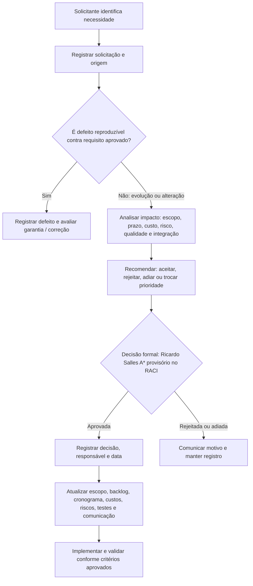

# 10 — Fluxo de Mudanças

**Projeto:** Vida+ — Sistema de Gestão e Agendamento de Clínica  
**Responsável pelo artefato:** Luís Gabriel (Pessoa 4 — Controle e go-live)  
**Status:** Revisão cruzada — alinhado à [Matriz RACI](../pessoa_1/Matriz%20RACI%20Vida%20Mais.md), às decisões Z-01–Z-07 do artefato 02 e ao impacto indicativo do [05 Custos](../pessoa_3/05%20Planejamento%20de%20Custos.md); Ricardo A* em mudança, Camila R

## Objetivo e regra

Controlar solicitações que alterem o escopo contratado, requisitos aprovados, premissas, integrações, regras, esforço ou condições de aceite. A linha de base do projeto é preditiva para escopo, prazo e preço; o backlog pode ser priorizado iterativamente dentro desses limites. Uma conversa, mensagem ou item de backlog não substitui a aprovação formal de uma mudança.

## Fluxo

## Etapas e registros

| Etapa | O que fazer | Registro mínimo |
|---|---|---|
| 1. Solicitar | Cliente ou integrante apresenta necessidade pelo canal acordado. | Solicitante, data, problema/benefício, área afetada e urgência. |
| 2. Registrar | GP ou pessoa designada atribui ID e confirma recebimento. | ID, descrição, origem, evidência e status “em análise”. |
| 3. Classificar | Comparar pedido com requisito, escopo e critérios aprovados; distinguir defeito de evolução. | Requisito de referência, resultado esperado/observado e classificação preliminar. |
| 4. Analisar impacto | Pessoas responsáveis estimam efeito em escopo, prazo, custo, risco, qualidade, integração, dados e operação. | Alternativas, esforço/custo, dependências, riscos, efeito no caminho crítico e recomendação. |
| 5. Decidir | Autoridade definida no RACI aprova, rejeita, adia ou aceita mediante troca de prioridade/escopo. | Decisão, autoridade, justificativa, condições e data. Trabalho que altera baseline não começa antes da aprovação. |
| 6. Comunicar | GP informa solicitante, equipe e áreas afetadas. | Destinatários, decisão e próximos passos. |
| 7. Atualizar artefatos | Atualizar apenas os planos e requisitos afetados e manter histórico/versionamento. | Versões atualizadas de escopo, backlog, cronograma, custos, riscos, qualidade e go-live quando aplicável. |
| 8. Implementar e verificar | Desenvolver/testar contra o requisito alterado e incluir evidência no ciclo de entrega. | Evidência de teste, versão e aceite aplicável. |

## Papéis e autoridade

Papéis conforme a Matriz RACI oficial da Pessoa 1. O RACI marca Ricardo como **A provisório** para aprovação de mudanças e Camila como **R**; confirmar formalmente a autoridade de Ricardo com a governança Vida+.

| Papel | Participação proposta |
|---|---|
| Solicitante | Usuário-chave/cliente ou integrante do projeto; registra a necessidade, mas não aprova a própria mudança. |
| Aprovação | Ricardo Salles (A* provisório na linha “Aprovação de mudança”); o asterisco indica que a autoridade final ainda precisa de confirmação formal pela Vida+. |
| Registro e coordenação | Camila Rocha (R): recebe e registra a solicitação, coordena análise de impacto e acompanha a decisão; sua designação formal como GP ainda está pendente. |
| Análise funcional/negócio | Bruno Ferraz (C) apoia análise de requisitos; Paula Ribeiro, Dra. Helena Moraes, Marcelo Viana, Fernanda Lopes e Juliana Reis são consultados conforme área afetada. |
| Análise técnica, qualidade e infraestrutura | Lívia Monteiro, Rafael Nunes, Diego Prado, Natália Campos e Igor Mendes (C) avaliam impactos de UX, desenvolvimento, testes e ambiente conforme a mudança. |
| Esclarecimento comercial | Henrique Tavares e Marina Couto (I) podem ser acionados para esclarecer premissas e compromissos da negociação; não aprovam a mudança por esse papel. |

O RACI atual não define um aprovador alternativo por baixo/médio/alto impacto: Ricardo é A* provisório para a atividade de aprovação de mudança. Até essa autoridade ser confirmada, Camila coordena a análise, registra a decisão pendente e não trata mudança de baseline como aprovada. Qualquer impacto em contrato ou preço exige validação formal conforme governança aplicável.

## Defeito, garantia e mudança

- **Defeito:** comportamento reproduzível divergente de requisito aprovado, em ambiente e condições suportados. Registrar evidências e tratar como correção do escopo; defeitos cobertos no período contratual de garantia seguem a OS.
- **Mudança/evolução:** funcionalidade nova, alteração de regra/requisito aprovado, integração adicional ou pedido que aumente esforço ou altere premissas/critério. Avaliar via Change Request antes de comprometer equipe.
- A classificação inicial pode ser reavaliada após comparar o pedido com a versão aprovada do requisito. A garantia não cobre melhorias ou novas funcionalidades.
- Homologação rejeitada precisa apontar cenário, resultado esperado, resultado obtido e evidência; divergência de requisito aprovado pode ser defeito, enquanto expectativa não aprovada deve ser analisada como mudança.

## Exemplo resolvido — confirmação por WhatsApp

**Pedido:** “Confirmar consultas por WhatsApp.” O handoff registra a preferência, mas canal, fornecedor, credenciais e custos precisam ser definidos; a proposta exclui serviços de mensageria/WhatsApp Business/API do valor contratado. A Decisão 2 do artefato 02 registra Z-01 como **Depois/CR** e define e-mail como baseline.

1. Registrar como solicitação e localizar o requisito aprovado de notificações.
2. Conferir a baseline: notificações por e-mail estão dentro; WhatsApp está adiado (Z-01) e não é aprovado pela nota informal.
3. Fazer análise indicativa: o artefato 05 estima 80 h adicionais de equipe (BA 16 h, backend 24 h, full stack 20 h, QA 12 h e DevOps 8 h), cerca de **R$ 11.200** de mão de obra, mais custo do serviço de mensageria pago pelo cliente e possível impacto de **1 a 2 semanas** no caminho crítico. O total estimado ficaria em cerca de **R$ 162.750**, acima do teto interno de R$ 158.000.
4. Recomendação: manter Z-01 em Depois/CR e usar e-mail no primeiro go-live. Se o cliente insistir em incluir WhatsApp, registrar Change Request e submeter a Ricardo Salles (A* provisório); Camila registra e coordena a análise. Não iniciar trabalho nem assumir custos sem aprovação formal e atualização do baseline.
5. Comunicar o adiamento e a alternativa de e-mail; se houver aprovação futura, documentar fornecedor, credenciais, responsabilidade pelo custo transacional, escopo e prazo, atualizar escopo/backlog, cronograma, custos, riscos e cenários de qualidade; depois implementar e validar disparo e conteúdo.

## Registro de mudanças

Manter um log compartilhado com: ID, solicitação, solicitante/data, requisito de referência, classificação (defeito/mudança), impactos, recomendação, autoridade/decisão/data, condição, artefatos atualizados, responsável e status. A GP apresenta mudanças abertas e aprovadas nas reuniões de acompanhamento.

## Pontos para validar

- Confirmar formalmente Ricardo Salles como autoridade final de aprovação; o RACI o marca A provisório e não define níveis alternativos por impacto.
- Definir canal oficial para solicitações e ferramenta/log compartilhado.
- PO na Decisão 3: **Bruno Ferraz** (prioridade backlog), validando Paula e Dra. Helena — coerente com RACI §6.
- Confirmar que os valores ilustrativos de horas/custo do exemplo seguem o artefato 05 vigente ao aprovar eventual CR.
- Alinhar processo de defeitos e aceite com o plano de qualidade e a cláusula contratual de homologação/garantia.
